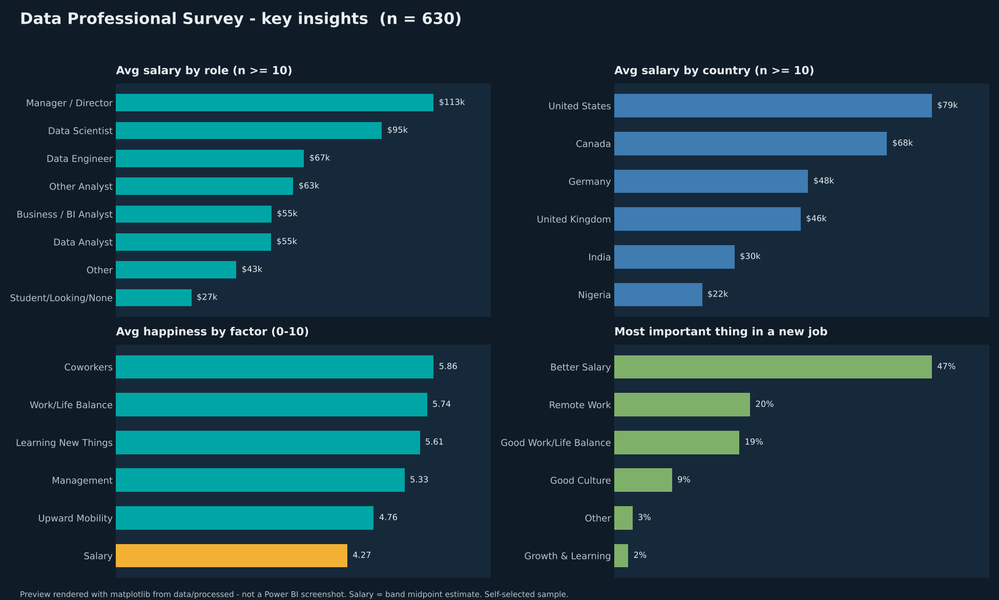
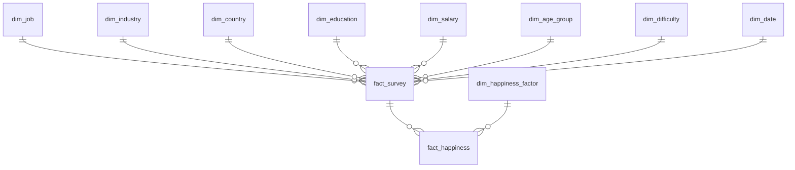

# 📊 Data Professional Survey - Advanced Power BI Project

An end-to-end analytics project on a 630-respondent survey of data professionals: **what they earn, how happy they are, how they
broke into data, and what they want next.** The repo contains everything needed to rebuild the Power BI report and to review it
on GitHub - cleaned star-schema data, Power Query (M), a DAX measure library, a theme, model documentation, automated data tests
and a page-by-page report specification.


<sub>Preview rendered from the cleaned data with Python (not a Power BI screenshot).</sub>

---

## What makes this "advanced"

| Area | What is implemented |
|---|---|
| **Data engineering** | Raw → star schema with **2 fact tables + 9 dimensions**; free-text "Other (Please Specify)" answers standardised by rule; PII/empty columns dropped; unpivoted happiness fact (3,722 rows) |
| **Power Query** | Parameterised paths (`pDataFolder`), 10 reusable custom functions, reference-data merges, null-safe unpivot, typed columns; logic mirrored 1:1 in Python |
| **Data quality** | 11 documented issues (impossible age, idle sessions, straight-liners, typos…) flagged or fixed, auto-generated [report](docs/data_quality_report.md) |
| **Data modelling** | Single-direction relationships, sort-by columns, hidden keys, mark-as-date-table, auto date/time off |
| **DAX (≈ 60 measures)** | Variables, `CALCULATE`/`REMOVEFILTERS`/`ALLSELECTED`, `RANKX`, `ADDCOLUMNS`+`CONCATENATEX`, time intelligence (`DATESINPERIOD`), Pareto, dynamic text, conditional-format colours |
| **Statistical safety** | A *Min Sample Size* what-if parameter blanks any segment with too few respondents |
| **Interactivity** | Field parameters (swap dimension & metric), what-if sliders, Top-N control, drillthrough, tooltip page, bookmarks |
| **Quality assurance** | 41 automated data checks (`tests/validate_data.py`) + a KPI QA checklist with expected values |
| **Governance** | Dark-teal theme JSON, `.gitattributes` for Git LFS, `.pbip`-ready workflow, documented assumptions & limitations |

## Headline findings

* 59% of respondents **switched careers** into data; average age is 29.8.
* **Location dominates pay:** US ≈ $79k vs UK ≈ $46k, India ≈ $30k, Nigeria ≈ $22k average salary-band midpoint.
* **Data Scientists (≈ $95k) earn ~70% more than Data Analysts (≈ $55k)**; managers/directors ≈ $113k.
* **Salary is the lowest-rated part of the job (4.3/10)**, followed by upward mobility (4.8/10); coworkers are rated highest (5.9/10).
* **47% want a better salary** most in their next job; remote work (20%) and work/life balance (19%) follow.

See [docs/INSIGHTS.md](docs/INSIGHTS.md) for all eleven findings and the caveats that go with them.

## Repository structure

```
├── data/
│   ├── raw/                Data_Professional_Survey.xlsx   (original, untouched)
│   ├── reference/          salary bands, education order, country→region, … (mapping tables)
│   └── processed/          fact_survey, fact_happiness, 9 dim_* CSVs  (output of the ETL)
├── scripts/
│   ├── clean_data.py       reference ETL + generates docs/data_quality_report.md
│   └── make_preview_chart.py
├── powerquery/             Power Query (M): parameter, 10 functions, staging, facts, dimensions
├── dax/
│   ├── measures.dax        measure library, organised in display folders
│   └── parameter_tables.dax what-if and field-parameter tables
├── model/data_model.md     ER diagram (Mermaid), relationships, model settings
├── theme/                  Power BI theme JSON
├── tests/validate_data.py  41 automated checks
├── docs/                   BUILD_GUIDE, REPORT_DESIGN, DATA_DICTIONARY, QA_CHECKLIST, INSIGHTS, data_quality_report
└── powerbi/                put the finished .pbix / .pbip here
```

## Data model



Details, relationship table and model settings: [model/data_model.md](model/data_model.md).

## Report pages

1. **Executive Summary** - KPI cards, salary-band distribution, country map, role mix, auto-generated insight text
2. **Salary Analysis** - dynamic dimension × metric chart (field parameters), decomposition tree, gender gap, what-if threshold
3. **Job Satisfaction** - happiness heat-map matrix, polarisation (happy / neutral / unhappy), salary-vs-happiness by industry
4. **Career Journey** - breaking-in difficulty, switchers vs non-switchers, job priorities, Pareto of industries
5. **Demographics & Tools** - age, gender, ethnicity, programming languages, regions
6. **Data Quality & Methodology** - response timeline, cumulative & moving average, quality KPIs, assumptions
7. *(hidden)* **Role Profile** drillthrough · **Segment tooltip**

Pixel-level specification: [docs/REPORT_DESIGN.md](docs/REPORT_DESIGN.md).

## Quick start

```bash
git clone <this-repo> && cd data-professional-survey-powerbi
pip install -r requirements.txt
python scripts/clean_data.py        # rebuilds data/processed + data quality report
python tests/validate_data.py       # 41 checks, exit code 0 = all pass
```

Then open Power BI Desktop and follow **[docs/BUILD_GUIDE.md](docs/BUILD_GUIDE.md)** (≈ 45-60 min): load the data
(Power Query from the raw file *or* the processed CSVs), create relationships, paste the DAX, apply the theme, build the pages.

## Assumptions & limitations

* Salary is collected as a **band**; all salary figures use the band **midpoint** (`225k+` is set to 250k - see `data/reference/salary_bands.csv`).
* The sample is **self-selected** (a data-analytics community) and **not representative** of the profession.
* Salaries are in USD with no cost-of-living adjustment; cross-country comparisons should be read with that in mind.
* Several segments are small (PhD n=5, `225k+` n=2); use the *Min Sample Size* control.
* Job-title, industry, language and ethnicity standardisation is **rule-based** (keywords); see `scripts/clean_data.py`.
* The M and DAX files were written and logic-checked against the Python reference implementation, but were authored outside
  Power BI Desktop - run the [QA checklist](docs/QA_CHECKLIST.md) after loading and treat any mismatch as a bug to fix.

## Data source & license

Survey data: *Data Professional Survey* (2022), provided with the project workbook; respondents are anonymous
(no e-mail, location or device data retained). Code in this repository is released under the [MIT License](LICENSE).
