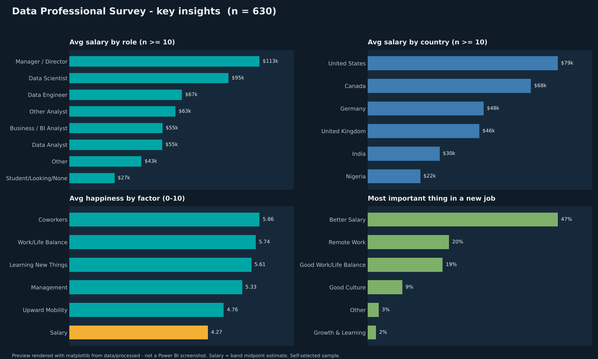

# Key Insights (from the cleaned data)

*Preview only - rendered in Python from `data/processed`; the Power BI report presents the same story interactively.*

| # | Finding | Evidence |
|---|---------|----------|
| 1 | **The audience is early-career and career-switching.** | Average age 29.8; 59% switched into data; 90% are under 40 |
| 2 | **Most respondents earn little in USD terms.** | 44% (275 of 630) are in the 0-40k band; average midpoint ≈ $54k |
| 3 | **Where you live matters more than almost anything else.** | US avg ≈ $79k vs UK $46k, India $30k, Nigeria $22k (each n ≥ 30) |
| 4 | **Seniority and specialisation pay.** | Manager/Director ≈ $113k (n=12), Data Scientist ≈ $95k (n=25) vs Data Analyst ≈ $55k (n=381) |
| 5 | **Salary is the weakest point of job satisfaction.** | Salary 4.27/10 and Upward Mobility 4.76/10 are the two lowest-rated factors; Coworkers (5.86) the highest |
| 6 | **Pay is what people would optimise for next.** | 47% say *Better Salary* is the most important thing in a new job, ahead of Remote Work (20%) and Work/Life Balance (19%) |
| 7 | **Money and happiness are only moderately linked.** | Correlation between salary midpoint and overall happiness ≈ 0.31 |
| 8 | **Breaking in is perceived as hard.** | 32% found it Difficult / Very Difficult; career switchers rate it slightly harder (3.16 vs 2.98 of 5) yet are somewhat happier (5.4 vs 5.0) |
| 9 | **A Master's degree is associated with higher pay.** | Masters ≈ $61k vs Bachelors ≈ $50k (PhD n=5 - too small to conclude) |
| 10 | **No gender pay gap is visible in this sample.** | Women's average midpoint is ~3% *higher* than men's; the sample is 26% women and heavily country-confounded - treat as inconclusive |
| 11 | **Python dominates.** | 67% name Python as their favourite language, then R (16%) and SQL (8%) |

## Caveats

- Self-selected audience of a data-analytics community, not a random sample of the profession.
- Salary is banded; figures are midpoint estimates and USD is not adjusted for cost of living.
- Several cuts have small *n*; the report greys out / blanks them via the *Min Sample Size* control.
- Correlation ≠ causation; none of the above is a statistical test.
