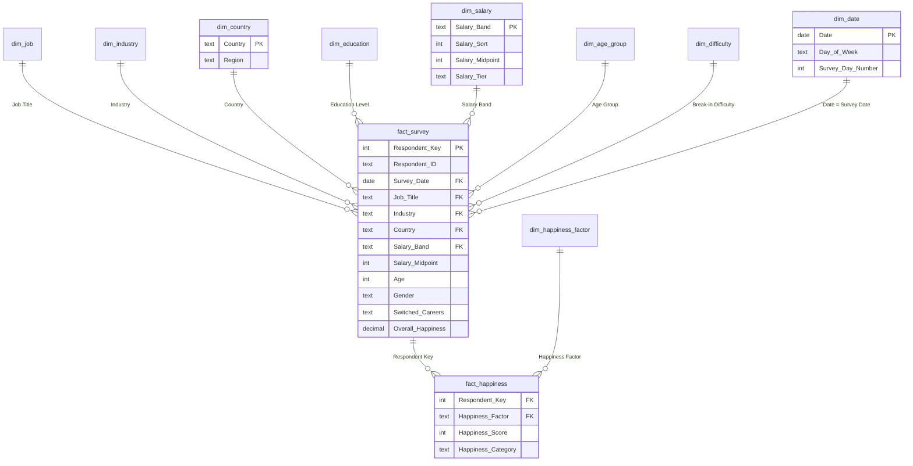

# Data Model

Star schema with **two fact tables** (different grains) and **nine dimensions**.

## Relationships

| From (many) | To (one) | Cardinality | Filter direction | Active |
|---|---|---|---|---|
| `fact_survey[Job Title]` | `dim_job[Job Title]` | * : 1 | Single (dim → fact) | Yes |
| `fact_survey[Industry]` | `dim_industry[Industry]` | * : 1 | Single | Yes |
| `fact_survey[Country]` | `dim_country[Country]` | * : 1 | Single | Yes |
| `fact_survey[Education Level]` | `dim_education[Education Level]` | * : 1 | Single | Yes |
| `fact_survey[Salary Band]` | `dim_salary[Salary Band]` | * : 1 | Single | Yes |
| `fact_survey[Age Group]` | `dim_age_group[Age Group]` | * : 1 | Single | Yes |
| `fact_survey[Break-in Difficulty]` | `dim_difficulty[Break-in Difficulty]` | * : 1 | Single | Yes |
| `fact_survey[Survey Date]` | `dim_date[Date]` | * : 1 | Single | Yes |
| `fact_happiness[Respondent Key]` | `fact_survey[Respondent Key]` | * : 1 | Single (fact_survey → fact_happiness) | Yes |
| `fact_happiness[Happiness Factor]` | `dim_happiness_factor[Happiness Factor]` | * : 1 | Single | Yes |

Because `fact_happiness` hangs off `fact_survey`, **every** slicer (role, country, gender, education …)
also filters the happiness-by-factor visuals - without any bi-directional filtering.

## Disconnected helper tables (no relationships)

`_Measures` (measure host) · `Min Sample Size` · `Salary Threshold` · `Top N` · `Dimension Selector` (field parameter) ·
`Metric Selector` (field parameter) - see `dax/parameter_tables.dax`.

## Model settings checklist

| Setting | Value |
|---|---|
| Auto date/time (File → Options → Data load) | **Off** (we have our own `dim_date`) |
| `dim_date` | Mark as date table → `Date` |
| Sort by column | `Salary Band` by `Salary Sort` · `Education Level` by `Education Sort` · `Age Group` by `Age Group Sort` · `Break-in Difficulty` by `Difficulty Score` · `Happiness Factor` by `Factor Sort` · `Month Name` by `Month Number` · `Day of Week` by `Day of Week Number` |
| Hide from report view | all foreign-key columns in the facts (`Job Title`, `Industry`, `Country`, `Education Level`, `Salary Band`, `Age Group`, `Break-in Difficulty`, `Survey Date`), `Respondent Key`, all `*Sort` columns, `Salary Midpoint` (use the measures) |
| Default summarization | **Don't summarize** for `Age`, `Salary Midpoint`, `Difficulty Score`, `Happiness Score`, years/keys |
| Data category | `dim_country[Country]` → *Country/Region* |
| Display folders | Per `// FOLDER:` comments in `dax/measures.dax` |
| Format strings | Per `// FORMAT:` comments in `dax/measures.dax` |

## Design decisions

* **Natural keys** (text) rather than surrogate integers: every dimension has ≤ 73 members, and keeping the readable
  value makes the model self-documenting and the CSVs easy to review on GitHub.
* **Low-cardinality attributes kept on the fact** (`Gender`, `Ethnicity`, `Favorite Language`, `Switched Careers`,
  `Top Job Priority`, `Response Quality`) - they have no extra attributes or sort order, so a dimension would add joins without benefit.
* **Happiness is modelled twice on purpose**: wide on `fact_survey` (respondent-level average, for scatter plots) and long
  in `fact_happiness` (one measure, one axis - lets a single visual compare all six factors).
* **Salary is a band**; the midpoint lives in `dim_salary` (single source of truth for the assumption) and is copied to the fact
  for fast aggregation.
